> 2026-11-09 最小实现说明：已接通本地单用户 Web。任务管理合并在 `server/jobs.py`，后台队列逐个启动算法 CLI 子进程；前端采用单页原生 HTML/CSS/JS。SQLite 仅记录任务元数据，算法产物继续遵守 manifest 契约。取消、对比 API、账号和小程序暂未实现。当前入口与使用方式见 [Web 服务](../server/README.md)，下文保留原始架构规划。
## 一句话结论
让 `cv_engine/` 把一次运行的所有东西（原帧、bbox、门控数值、OCR 框、条目、笔记、统计）实时写进 `runs/<run_id>/`，并用 `manifest.json` 做总索引；FastAPI 只负责「收视频 → 起任务 → 给状态 → 发文件」，三个消费方（用户前端、工作展示台、评测脚本）都只读这一份 manifest。

(好处：
1. 展示台页面每个数字都能回溯到 manifest 的一个字段。
2. C / D 两位做算法的同学可以纯 CLI 跑 `python -m cv_engine --video ...`，不用等后端、不用起服务，跑完立刻看展示台。
3. A / B / C / D / E 五个人的接口就是一份 `contracts.py`，冻结后互不阻塞。
)

---

## 三条设计原则

### 产物即契约（最重要）
**展示台上出现的任何数字或图片，都必须对应 `manifest.json` 里的一个字段或一条 artifact 记录；产物缺失就显示「缺失」，绝不补图、绝不反推。**
### 算法内核与 Web 解耦
`cv_engine/` 不 import FastAPI、不 import 任何前端东西，只依赖 OpenCV / PaddleOCR / ultralytics。
它有两个入口：
- CLI：`python -m cv_engine --video data/videos/clip01.mp4 --config evaluation/configs/C_zone.yaml`
- 函数：`pipeline.run(video_path, config, writer)`，由 `server/runner.py` 在后台线程里调用。
### 配置进版本库，产物不进
`evaluation/configs/*.yaml`、`data/annotations/`、`docs/`、`contracts.py` 进 git；
`runs/`、`data/videos/`、`*.mp4`、`__pycache__/`、模型权重、`.env` 全部 gitignore。
每次运行把实际生效配置快照成 `runs/<run_id>/config.yaml`，保证 A/B/C/D 四组实验可复现、可归因。

---

## 推荐目录结构
```
视觉课设/
├── README.md                          # 一键启动 + 目录导航
├── pixi.toml / pixi.lock              # 已有，扩展 deps 与 tasks
├── .env.example                       # 密钥 / 路径模板（绝不提交真密钥）
├── .gitignore                         # runs/ data/videos/ *.mp4 .env __pycache__/
│
├── docs/                              # 架构 / 开发拓扑 / 标注规范（字段权威在代码，见「产物契约」）
│
├── cv_engine/                         # ★ 纯算法内核，零 Web 依赖
│   ├── __init__.py
│   ├── contracts.py                   # ★ 唯一权威字段定义（dataclass，仅标准库）
│   ├── schema.py                      # ★ JSON Schema + validate_manifest()
│   ├── manifest.schema.json / experiment.schema.json   # schema.py 导出，供非 Python 消费
│   ├── writer.py                      # ★ 唯一落盘口：逐阶段增量写 manifest
│   ├── config.py                      # 参数 dataclass，支持 yaml 覆盖
│   ├── tests/                         # 契约往返 / 校验 / writer → workbench 端到端
│   ├── pipeline.py                    # 顺序编排 + 计时 + 失败降级
│   ├── cli.py                         # python -m cv_engine ...
│   ├── stages/
│   │   ├── s01_frames.py              # 抽帧 + 清晰度 + 时间戳
│   │   ├── s02_board.py               # 四点标定 / 透视校正（替代 HSV 单点定位）
│   │   ├── s03_pose.py                # YOLOv8n-pose + 遮挡估计
│   │   ├── s04_gate.py                # 变化检测 + 分区/条目级门控状态机
│   │   ├── s05_enhance.py             # 增强（同时保留原彩色帧）
│   │   ├── s06_ocr.py                 # ★ 输出 poly / score / frame / ts，中文模型
│   │   ├── s07_items.py               # ★ 条目级跨帧跟踪（项目核心）
│   │   ├── s08_notes.py               # TXT / PDF，中文字体嵌入，两版内容一致
│   │   └── s09_stats.py               # 教师统计，指标之和自洽
│   └── adapters/                      # 复用 / 魔改基础项目模块的封装层
│       ├── ocr.py  pose.py  enhance.py
│
├── server/                            # FastAPI 薄壳，不做 CV
│   ├── app.py  settings.py  db.py     # SQLite: jobs 表
│   ├── runner.py                      # 单实例队列 / 线程，调用 pipeline.run()
│   ├── schemas.py                     # Pydantic，字段与 contracts.py 对齐
│   └── api/
│       ├── jobs.py                    # 创建 / 查询 / 取消任务
│       ├── runs.py                    # manifest 与产物清单
│       ├── files.py                   # 白名单静态文件下发，防目录穿越
│       └── health.py
│
├── web/                               # 用户前端（H5 优先）
│   ├── index.html                     # 选择视频 → 上传 → 进度 / 阶段
│   ├── result.html                    # 笔记、条目证据、教师统计、下载
│   ├── css/  js/
│   └── miniprogram/                   # 微信原生小程序（可裁剪层，共用同一套 API）
│
├── workbench/                         # ★ 工作展示台生成器（不是站点）
│   ├── build.py                       # ★ 只读 manifest → 生成单文件 index.html
│   ├── core/  static/                 # 组件：时间轴 / 漏斗 / 对照滑杆 / 证据卡 / lightbox
│   ├── partitions/                    # run 页：01–09 各阶段 YAML
│   ├── partitions_experiment/         # 实验页：变体对照 YAML
│   ├── annotations/                   # 各 stage 的代码文件 / 核心函数 / 参数标注
│   └── README.md                      # 给 cv_engine 的对接说明
│
├── runs/                              # ★ 运行时唯一数据源（gitignore）
│   └── <run_id>/
│       ├── manifest.json              # ★ 一次运行的完整索引
│       ├── config.yaml                # 参数快照
│       ├── log.jsonl                  # 结构化日志（逐帧 / 逐次 OCR）
│       ├── 01_frames/  02_board/  03_pose/  04_gate/  05_enhance/
│       ├── 06_ocr/     07_items/   08_notes/ 09_stats/
│       └── index.html                 # build.py 产物，可双击打开
│
├── experiments/                       # 单阶段调参实验（gitignore，允许删）
│   └── <exp_id>/
│       ├── manifest.json              # kind: experiment；samples[] × variants[]
│       ├── media/                     # 各变体结果图
│       └── index.html                 # build.py 产物
│
├── data/
│   ├── videos/                        # 授权短视频（gitignore）
│   ├── annotations/                   # 标注 JSON（进 git）
│   └── consent/                       # 授权 / 脱敏 / 留存期限记录
│
├── evaluation/
│   ├── evaluate.py                    # 召回 / 精确率 / CER / 重复率 / OCR 次数 / 耗时
│   ├── configs/{A_fixed,B_full,C_zone,D_ablation}.yaml
│   └── reports/
│
└── scripts/
    ├── run_one.sh                     # 纯 CLI 跑一条视频并重建展示台
    ├── dev.sh                         # 起后端 + 打开前端
    └── freeze_baseline.py             # 把基础项目 output/ 固化成 baseline A 记录
```

### 每阶段目录里放什么

| 目录 | 必须落盘的内容 | 展示台上的形态 |
|---|---|---|
| `01_frames/` | 代表帧 JPG、时间轴联系表、逐帧抽样记录 | 联系表 + 帧数量漏斗 + 具体图片样本展示|
| `02_board/` | 四点标定图、透视校正图、每帧 bbox | bbox 叠加图 + 稳定性曲线 |
| `03_pose/` | 骨架叠加帧、遮挡率曲线 | 姿态联系表 + 遮挡反例 + 带有pose识别框的视频段落 |
| `04_gate/` | 逐帧 SSIM / 差分 / clarity / 触发标记 | 门控曲线 + 逐帧表 + 具体图片展示(标注好SSIM) |
| `05_enhance/` | **原始彩色帧** + 增强灰度图（两者都留） | 彩色 vs 灰度对照滑杆 |
| `06_ocr/` | 每次调用的框 JSON + 检测框叠加图 + 原帧 | 逐次 OCR 卡片 + lightbox |
| `07_items/` | 每个条目的裁剪图、bbox 叠加图、生命周期 | 条目证据卡（核心页面） |
| `08_notes/` | `notes.txt` / `notes.pdf` / 逐行原文对照 | 并排对照 + 内联 PDF |
| `09_stats/` | `analytics.json` + 时间轴图 | 指标卡 + 时间轴 |

> 硬性要求：`05_enhance/` 必须同时保存**原始彩色帧**。基础项目只存增强后的灰度放大图，是「可核验」承诺失效的直接原因之一。
> 尽量多放真实的流水线中间产物，提高透明感、可观性。

### 工作展示台的两种页面

`workbench/build.py` 按 `manifest.kind` 生成两类页面，共用同一套组件与视觉：

- **run 页** `runs/<run_id>/index.html`：一次完整流水线，9 个阶段首尾相接；低频、归档、进答辩。
- **实验页** `experiments/<exp_id>/index.html`：单个 stage × N 个变体，列=变体 / 行=同一样本；一天多次、允许删。

**上表「展示台上的形态」属于 run 页。** 04 图上 SSIM 数值、05 彩色/灰度对照滑杆、06 逐次 OCR 卡片、08 并排对照、09 时间轴都是流水线中间产物本身的展示方式，不是实验专属，留在 run 页。实验页是否复用这些组件取决于该次实验内容（OCR 调参可能需要逐次卡片与并排对照，门控调参可能需要 SSIM 曲线），不做硬性归类。

判据只有一条：产物来自一次完整流水线 → run 页；来自某成员为调参单独跑的单阶段变体 → 实验页。组件两层通用，不是二选一。

---

## 产物契约（唯一权威 = 代码）

**`cv_engine/contracts.py` 是字段的唯一权威**，`cv_engine/schema.py` 是机读校验，`cv_engine/writer.py` 是唯一落盘口。此处不再复制 schema：原先手写的 `stages: list`、`duration_sec`、`artifacts[]` 与 workbench 实际消费的字段冲突，是开工时的头号阻塞，已废弃。

| 顶层字段 | 类型 | 说明 |
|---|---|---|
| `schema_version` | str | `1.0`；只能加字段，不能改已有字段含义 |
| `kind` | str | 缺省 `run`；`experiment` 走实验页 |
| `run_id` `title` `created_at` `status` | str | 运行标识、页面标题、运行状态 |
| `video` | `VideoMeta` | `name` `fps` `frames` **`duration_s`** `width` `height`（不是 `duration_sec`） |
| `stages` | `dict[str, StageResult]` | 键 `"01"`–`"09"`；`status` ∈ `done / running / pending`（驱动页签三态） |
| `items[]` | `BoardItem` | `item_id` `text` `first_seen_sec` `last_seen_sec` `frame` `crop` `ocr_link` `status`；另有 `bbox` `best: OcrBox` `evidence` `archived` 供评测 |
| `compare[]` `files[]` | `dict` / `FileEntry` | A/B/C/D 对照行；`{path, size}` 产物索引 |
| `config` `outputs` `warnings` | dict / dict / list | 配置快照、笔记与分析输出、告警 |

指标键 `stages.<no>.metrics.*` 与数据表路径被 `workbench/partitions/*.yaml` 硬编码，改名需同步 YAML：

| 阶段 | 指标键 | 数据表 / 文本 |
|---|---|---|
| 01 | `sampled` `blur_dropped` | `01_frames/frames.json` |
| 02 | `located` `confidence` | — |
| 03 | `pose_frames` `occluded` | — |
| 04 | `passed` `pass_rate` | `04_gate/gate.json` |
| 05 | `snapshots` `clarity` | — |
| 06 | `calls` `boxes` `score` | `06_ocr/calls.json` |
| 08 | `sections` `chars` | `08_notes/notes.md` |
| 09 | `elapsed_s` `mem_mb` | `09_stats/summary.json` |

**规则**

- 所有 `path` 相对 `runs/<run_id>/`，禁止绝对路径与 `..`；媒体放进 `media/<stage>/` 即被 `glob` 自动收录。
- `status` 三态用于页签显示；条目「擦除后归档」是 `archived: bool`，不要塞进 `status`（工作台只认三态）。
- 产物缺失显示「缺失」，不补图、不反推；`build.py` 不读 manifest 之外的数据。
- writer 用原子替换写 manifest，配合 `--watch` 得到实时进度页。
- 校验：`python -m cv_engine.schema`（导出 JSON）、`validate_manifest()`；冻结后改字段须全员评审并升 `schema_version`。

---

## 接口清单（前端 / 展示台共用）

| 方法 | 路径 | 用途 |
|---|---|---|
| `POST` | `/api/jobs` | multipart 上传视频 + `config` 预设 → `{job_id, run_id}` |
| `GET` | `/api/jobs/{id}` | 状态、当前阶段、进度、错误原因、重试 |
| `GET` | `/api/runs` | 列出全部 run（展示台的多 run 切换 / 对比） |
| `GET` | `/api/runs/{run_id}/manifest` | 返回 `manifest.json` |
| `GET` | `/api/runs/{run_id}/files/{path}` | 白名单下发产物，禁止 `..` |
| `GET` | `/api/runs/compare?ids=A,B,C` | A/B/C/D 指标并排（评测与展示台共用） |
| `GET` | `/api/health` | 存活检查 |

SQLite 只存 `jobs` 表的状态元数据（job_id 用不可枚举 ID），**不存产物内容**；产物一律在 `runs/` 目录。`job_id` 恢复查询必须配 token，否则可枚举读取他人视频。

前端选型建议：**H5 先做，小程序作为可裁剪层**。两者调同一套 API，不算砍掉前端。微信原生小程序要求 HTTPS 已备案域名、`uploadFile` 有大小与超时限制、真机联调周期长，把它放到第 11 周之后再上；如果时间紧，小程序只保留「结果查看」，上传走 H5。

---

## 附：最小验收清单

- [ ] `cv_engine/tests` 全绿；`manifest.schema.json` 与 `schema.py` 一致
- [ ] `writer.py` 产出的 manifest 通过 `validate_manifest()`，`files[].path` 全部真实存在
- [ ] `workbench/build.py --run <id>` 单文件 HTML 双击可看、断网可看
- [ ] `evaluation/evaluate.py` 只依赖 manifest 与标注即可算出召回 / 精确率 / CER
- [ ] 同一份 config 连跑两次，manifest 除时间戳外一致

